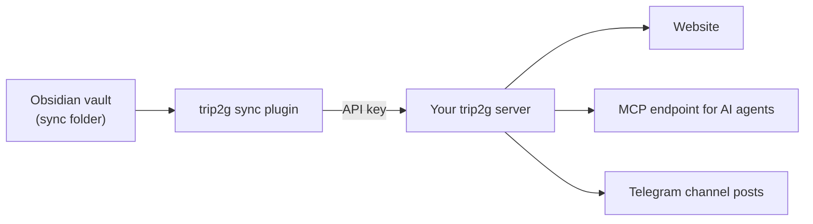
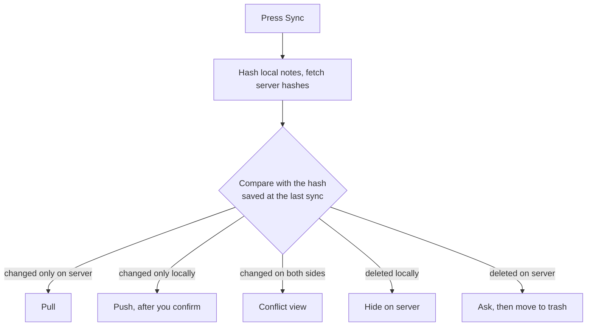

# trip2g sync

This plugin syncs a folder of your Obsidian vault with your own [trip2g](https://github.com/trip2g/trip2g) server, which publishes the notes as a website.

## Caution

**Back up your vault before you turn on two-way sync.** With two-way sync on, the plugin writes files into your vault and can move files to the trash when they are gone from the server (it asks you first).

We have not tested two-way sync next to another sync tool (Obsidian Sync, iCloud, Git) on the same folder. If you try it, back up first.

## What you need

A trip2g server and an API key for it. Pick one:

- Self-host trip2g. It is open source under the MIT license: https://github.com/trip2g/trip2g
- Try the free sandbox at https://simplecloud.2pub.me. It has no SLA and no backups.

The API key comes from the admin panel of your server (API Keys). The plugin has no paid features and does not take payments.

## Features

- Push the notes of one or more vault folders to your server, with the attachments they link to.
- Optional two-way sync: pull edits made on the server back into the vault.
- Optional live pull: server edits show up in the vault without pressing Sync.
- Optional auto-sync on save.
- Only push notes that have a frontmatter field such as `publish: true`.
- Open or copy a note's published link from the status bar, the note's `...` menu, or the command palette.
- Runs on desktop and mobile.

## What happens to your notes



The server stores the note text, its frontmatter and its attachments. A note is private by default: only admins and signed-in subscribers can read it, and `free: true` in the frontmatter makes it a public page. The server keeps every version of every note, so an overwritten note can be recovered. Details are in the [trip2g docs](https://trip2g.com/en/user).

## Network use

The plugin talks to the server URL you enter in its settings and sends no telemetry.

- **What is sent.** Notes from the folder you pick in settings (the vault root by default): `.md` files, plus `.canvas`, `.base`, `.excalidraw`, `.html` and `.html.json` files. Attachments go only when a pushed note links to them and they sit inside that folder. Nothing outside the folder is sent.
- **Where it goes.** To `<your server>/_system/graphql`, with your API key and the plugin version in the request headers.
- **What you see first.** Before a manual sync pushes notes, the plugin lists them and waits for you to confirm. Attachments are not in that list. The list is skipped when you turn on "Skip push confirmation" or tick "don't ask again", and auto-sync on save never shows it.
- **Background requests.** At startup the plugin asks the server for the published URL of each note. Every 5 minutes and when the window gets focus it asks the server for note hashes, to show pending changes on the ribbon icon (unless you hide the sync status). Nothing is uploaded by these requests.
- **Two-way sync** downloads changed notes and their attachments. An attachment URL can point to the storage your server uses (for example S3); the API key is only sent when that URL is on your server.
- **Live pull** keeps one event stream open to `/_system/graphql` on the same server.

## How sync works



1. For every note the plugin compares three hashes: the local file, the server copy, and the copy it saw at the last sync. It keeps those last-sync hashes on this device, per vault.
2. Changed only locally, or new locally: pushed to the server.
3. Changed only on the server, or new on the server: pulled into the vault. This needs two-way sync, which is off by default. Without it nothing is written to your vault, and a note changed on both sides is pushed, so the local version wins.
4. Changed on both sides (two-way sync): the conflict view shows both versions and lets you pick "Keep local", "Use server", "Keep both" (the server version is saved as `note (server).md`) or "Skip".
5. On the first sync, when local and server copies differ, you choose "Trust server for all" or "Review each conflict".
6. Deleted locally: the note is hidden on the server.
7. Deleted on the server (two-way sync): the plugin lists the files and asks whether to delete them locally. Deleted files go to the trash.
8. Live pull is off by default. It needs two-way sync and at least one include pattern in the folder settings. It writes a note only when it is new or you have not edited it since the last sync. A note edited on both sides is left alone and flagged for the next manual sync, and deletions on the server still ask first.
9. Auto-sync on save is off by default. It pushes a few seconds after you save and skips conflicts.

## Limitations

- You need a trip2g server. The plugin does nothing without one.
- The API key is stored in plain text in the plugin's `data.json`. Don't share that file.
- Two sync folders that point to the same server URL share one sync state.
- Attachments outside the sync folder are not uploaded.
- Without two-way sync, a note edited both on the server and in the vault is pushed, and the vault version replaces the server one.

## Installation

This plugin is not yet available in the official Obsidian Community Plugins directory. You can install it using [BRAT](https://tfthacker.com/BRAT) (Beta Reviewers Auto-update Tester).

### Install via BRAT

1. Install the BRAT plugin from Obsidian Community Plugins
2. Open BRAT settings in Obsidian
3. Click "Add Beta plugin"
4. Enter this repository URL: `https://github.com/trip2g/obsidian-sync`
5. Click "Add Plugin"
6. Enable "trip2g sync" in Obsidian Settings → Community Plugins

## Configuration

1. Open Obsidian Settings → trip2g sync.
2. Pick the folder to sync. The default is the whole vault.
3. Enter your server URL as "API URL", for example `https://yoursite.trip2g.com`.
4. Paste the API key from your server's admin panel.

## Usage

- Use the ribbon icon to sync. The icon shows a badge when there are changes to push or pull.
- Access sync commands from the command palette (Ctrl/Cmd + P)
- Open or copy a note's published link from the note's `...` menu, or via the
  "Open published URL in browser" / "Copy published URL of current file"
  commands (on mobile these can be pinned to the toolbar)

## Questions, suggestions or bugs

- Bugs in the plugin: [obsidian-sync issues](https://github.com/trip2g/obsidian-sync/issues).
- Questions about the server, publishing or hosting: [trip2g issues](https://github.com/trip2g/trip2g/issues) or the [docs](https://trip2g.com/en/user).

## Development

### Building from source

```bash
# Install dependencies
npm install

# Development mode (watch for changes)
npm run dev

# Build for production
npm run build
```

### Manual installation for development

1. Clone this repository to your vault's plugins folder:
   ```bash
   cd /path/to/vault/.obsidian/plugins
   git clone https://github.com/trip2g/obsidian-sync trip2g
   ```
2. Install dependencies: `npm install`
3. Build the plugin: `npm run dev`
4. Reload Obsidian
5. Enable the plugin in Settings → Community Plugins

## Author

Created by Alexey Yurchenko

- Website: [trip2g.com](https://trip2g.com)
- Email: alexes.dev@gmail.com
